> Visual Assist 기본 단축키 기준이다. VA는 Visual Studio에 이미 할당된 키를 **덮어쓰지 않으므로** 환경에 따라 일부 단축키가 비어 있을 수 있다. † 표시는 설치 직후에는 할당되지 않고 `VAssistX › Help › Keyboard Shortcuts › Recommended` 에서 권장 단축키를 수락했을 때 할당되며, ‡ 표시는 권장 수락 시 텍스트 에디터 밖(전역)으로 범위가 확장된다. 현재 바인딩은 `VAssistX › Help › Keyboard Shortcuts` 에서 확인하고, 변경은 `Tools › Options › Environment › Keyboard` 의 `VAssistX.*` 명령에서 한다. 출처: Whole Tomato 공식 문서 [Keyboard Shortcuts](https://www.wholetomato.com/en/documentation/configuration/keyboard-shortcuts) (Updated Jun 2026).
{: .prompt-info }

## 자주 쓰는 단축키

| 단축키 | 동작 |
| :--- | :--- |
| <kbd>Alt</kbd>+<kbd>G</kbd> | 선언부 ↔ 구현부 이동 (GoTo Implementation) — 대상이 여럿이면 메뉴 표시 |
| <kbd>Shift</kbd>+<kbd>Alt</kbd>+<kbd>G</kbd> | 관련 심볼로 이동 (GoTo Related) — 기반 클래스·오버라이드·타입 등 |
| <kbd>Alt</kbd>+<kbd>O</kbd> | 대응 파일 열기 (Open Corresponding File) — .h ↔ .cpp |
| <kbd>Shift</kbd>+<kbd>Alt</kbd>+<kbd>O</kbd> ‡ | 솔루션 내 파일 열기 (Open File in Solution) |
| <kbd>Shift</kbd>+<kbd>Alt</kbd>+<kbd>S</kbd> | 솔루션 내 심볼 찾기 (Find Symbol in Solution) |
| <kbd>Shift</kbd>+<kbd>Alt</kbd>+<kbd>F</kbd> | 참조 찾기 (Find References) |
| <kbd>Alt</kbd>+<kbd>M</kbd> | 파일 내 메서드 목록 (List Methods in File) |
| <kbd>Shift</kbd>+<kbd>Alt</kbd>+<kbd>Q</kbd> | 빠른 작업 및 리팩터링 메뉴 (Quick Action and Refactoring) |
| <kbd>Shift</kbd>+<kbd>Alt</kbd>+<kbd>R</kbd> | 이름 바꾸기 (Rename) — 선언·정의·모든 참조 일괄 |

## 탐색

### 심볼 · 파일 이동

| 단축키 | 동작 |
| :--- | :--- |
| <kbd>Alt</kbd>+<kbd>G</kbd> | 선언부 ↔ 구현부 이동 (GoTo Implementation) |
| <kbd>Shift</kbd>+<kbd>Alt</kbd>+<kbd>G</kbd> | 관련 심볼로 이동 (GoTo Related) |
| <kbd>Alt</kbd>+<kbd>O</kbd> | 대응 파일 열기 (Open Corresponding File) |
| <kbd>Shift</kbd>+<kbd>Alt</kbd>+<kbd>O</kbd> ‡ | 솔루션 내 파일 열기 (Open File in Solution) |
| <kbd>Shift</kbd>+<kbd>Alt</kbd>+<kbd>S</kbd> | 솔루션 내 심볼 찾기 (Find Symbol in Solution) |
| <kbd>Alt</kbd>+<kbd>M</kbd> | 파일 내 메서드 목록 (List Methods in File) — VA Outline 없이 현재 파일의 클래스·메서드로 점프 |

### 위치 이동

| 단축키 | 동작 |
| :--- | :--- |
| <kbd>Alt</kbd>+<kbd>←</kbd> ‡ | 이전 위치로 (Navigate Back) |
| <kbd>Alt</kbd>+<kbd>→</kbd> † | 다음 위치로 (Navigate Forward) |
| <kbd>Alt</kbd>+<kbd>↑</kbd> † | 이전 스코프로 (Move to Previous Scope) |
| <kbd>Alt</kbd>+<kbd>↓</kbd> † | 다음 스코프로 (Move to Next Scope) |

## 검색

| 단축키 | 동작 |
| :--- | :--- |
| <kbd>Shift</kbd>+<kbd>Alt</kbd>+<kbd>F</kbd> | 참조 찾기 (Find References) — 결과 창에서 파일별 그룹·읽기/쓰기 구분 |
| <kbd>Alt</kbd>+<kbd>K</kbd> † | 커서 단어 강조 (Find Selected) — Ctrl+F 검색을 실행한 것처럼 인스턴스 하이라이트 |
| <kbd>Shift</kbd>+<kbd>Alt</kbd>+<kbd>H</kbd> | VA Hashtags 창 열기 — 주석 내 `#tag` 북마크 모음 |

## 편집

### 리팩터링 · 코드 생성

| 단축키 | 동작 |
| :--- | :--- |
| <kbd>Shift</kbd>+<kbd>Alt</kbd>+<kbd>Q</kbd> | 빠른 작업 및 리팩터링 메뉴 (Quick Action and Refactoring) — Extract Method, Add Include, Document Method 등은 기본 단축키가 없어 이 메뉴에서 실행 |
| <kbd>Shift</kbd>+<kbd>Alt</kbd>+<kbd>R</kbd> | 이름 바꾸기 (Rename) |
| <kbd>Shift</kbd>+<kbd>Alt</kbd>+<kbd>C</kbd> | 사용처로부터 생성 (Create From Usage) — 미정의 심볼에서 선언·정의 생성 |

### 선택 (Smart Select)

| 단축키 | 동작 |
| :--- | :--- |
| <kbd>Shift</kbd>+<kbd>Alt</kbd>+<kbd>]</kbd> † | 선택 확장 (Smart Select Extend) — 작은 단위 |
| <kbd>Alt</kbd>+<kbd>]</kbd> | 블록 선택 확장 (Smart Select Extend Block) — 큰 단위 |
| <kbd>Shift</kbd>+<kbd>Alt</kbd>+<kbd>[</kbd> † | 선택 축소 (Smart Select Shrink) |
| <kbd>Alt</kbd>+<kbd>[</kbd> | 블록 선택 축소 (Smart Select Shrink Block) |

### 클립보드 · 보기

| 단축키 | 동작 |
| :--- | :--- |
| <kbd>Ctrl</kbd>+<kbd>Shift</kbd>+<kbd>V</kbd> † | 다중 클립보드 붙여넣기 메뉴 (Multiple Clipboards) |
| <kbd>Ctrl</kbd>+<kbd>0</kbd> † | 에디터 확대 100% 리셋 (Reset Editor Zoom) |

## Top Visual Assist Features

> 출처: Whole Tomato [Top Visual Assist Features](https://www.wholetomato.com/ko/learn/top10) (한국어 페이지 원문 그대로 옮김)
{: .prompt-info }

### #1 파일 열기 (Shift+Alt+O)

##### 간단한 대화상자와 몇 가지 검색 토큰을 사용하여 솔루션 안의 어떤 파일이든 찾아서 엽니다.

이 예제에서는 파일 이름에 "player"과 "swim"이 들어있고"multi"는 없는 파일을 찾고 1024 행에서 선택한 파일을 엽니다. [<i class="fas fa-up-right-from-square"></i>](https://docs.wholetomato.com/default.asp?W193)

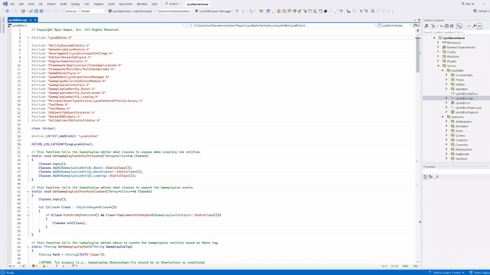

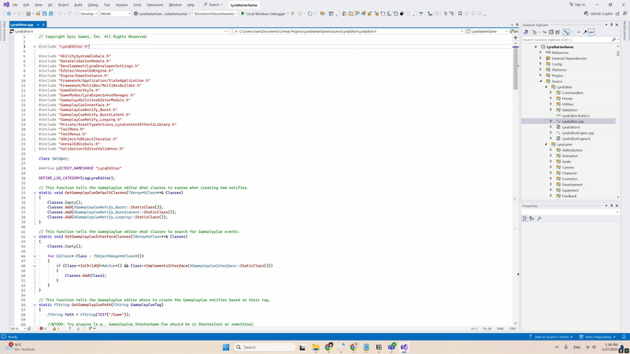

### #2 심볼 찾기 (Shift+Alt+S)

##### 필터링 지원이 되는 유사한 대화상자에서 솔루션 안에 있는 심볼을 찾습니다.

고급 사용자가 되려면 Visual Assist의 모든 대화상자 마다 해당 컨텍스트 메뉴를 탐색하십시오. [<i class="fas fa-up-right-from-square"></i>](https://docs.wholetomato.com/default.asp?W194)

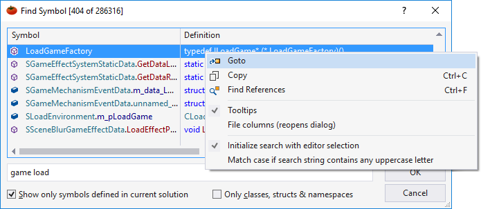

### #3 구현으로 이동 (Alt+G)

##### Visual Studio에 비슷한 기능이 있음에도 불구하고, 정의와 구현을 찾고 이동할 때 많은 사용자들이 기본 제공 인텔리센스 대신 Visual Assist에 의지합니다.

Alt+G는 여러 대상이 검색된 경우 메뉴를 엽니다. [<i class="fas fa-up-right-from-square"></i>](https://docs.wholetomato.com/default.asp?W191)

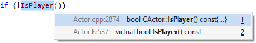

### #4 관련 항목으로 이동 (Shift+Alt+G)

##### Alt+G의 큰형인Shift+Alt+G는 현재 심볼과 관련된 거의 모든 곳으로 이동할 수 있습니다.

Alt+G를 연속적으로 눌러 구현을 추적하는 대신 Shift+Alt+G를 사용하여 계층 구조로 추적할 수 있습니다.

클래스 대한 참조 어느 곳에서도 기본 또는 파생 클래스로 직접 이동할 수 있습니다. [<i class="fas fa-up-right-from-square"></i>](https://docs.wholetomato.com/default.asp?W478)

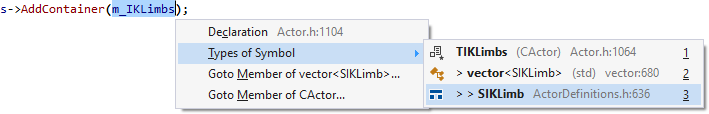

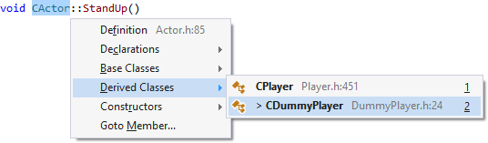

### #5 해당 파일 열기 (Alt+O)

##### 활성 문서와 가장 관련이 있는 파일을 엽니다.

C / C++에서 Alt+O는 일반적으로 해당 헤더 또는 소스 파일을 엽니다. Alt+O는 대상이 둘 이상인 경우 메뉴를 엽니다. [<i class="fas fa-up-right-from-square"></i>](https://docs.wholetomato.com/default.asp?W195)

원래 목적지로 돌아가려면 Alt+O를 누르고 이어서 Alt+왼쪽 화살표를 누르십시오. [<i class="fas fa-up-right-from-square"></i>](https://docs.wholetomato.com/default.asp?W197)

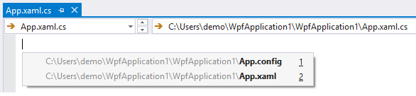

### #6 참조 찾기 (Shift+Alt+F)

##### 기본 제공 참조 찾기가 수년 동안 개선되었지만, Visual Assist의 참조 찾기가 여전히 더 빠르고 강력하며 종종 더 완벽합니다.

아이콘 또는 컨텍스트 메뉴를 통해 결과 창을 복제할 수 있습니다. 그러면 초기 결과를 덮어 쓰지 않고 검색을 추가 실행할 수 있습니다. [<i class="fas fa-up-right-from-square"></i>](https://docs.wholetomato.com/default.asp?W189)

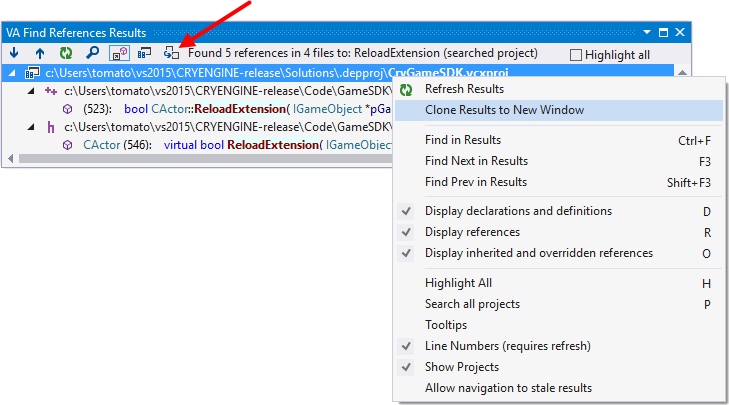

### #7 빠른 작업 및 리팩토링 메뉴 (Shift+Alt+Q)

##### Shift+Alt+Q를 사용하면, 현재 컨텍스트에서 적용되는 Visual Assist의 기능에 액세스합니다. 메뉴의 내용은 상황에 맞게 크게 다릅니다. 여러가지 타입, 표현, 선 및 공백 등 다양한 심볼에서 테스트해 보십시오.

예 : 작업하면서 생성하기, 가상 메소드 구현하기 등) 메뉴의 리팩토링 및 코드 생성 명령에 사용되는 VA스니펫의 간격 및 형식을 조정합니다.

VAssistX \| Tools \| Edit VA Snippets를 통해 스 니펫 편집기를 엽니다. 그리고 나서. [<i class="fas fa-up-right-from-square"></i>](https://docs.wholetomato.com/default.asp?W171)

Shift+Alt+Q와 동일한 메뉴를 여는 플로팅 버튼을 비활성화합니다. [<i class="fas fa-up-right-from-square"></i>](https://docs.wholetomato.com/default.asp?W382)

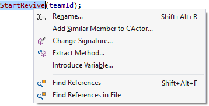

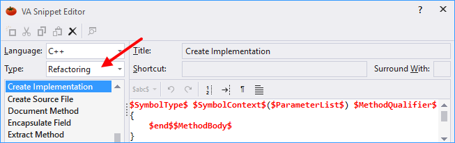

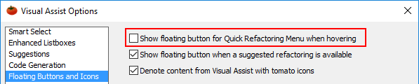

### #8 파일의 메소드 나열 (Alt+M)

##### 현재 파일을 탐색할 때 간단한 드롭다운 하나로, 파일 안에 있는 클래스와 메소드로 이동합니다.하위 문자열을 사용하여 목록을 필터링합니다.

작은 아래쪽 화살표에서 컨텍스트 메뉴를 열고 목록의 내용을 조정합니다. [<i class="fas fa-up-right-from-square"></i>](https://docs.wholetomato.com/default.asp?W192)

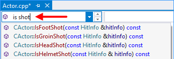

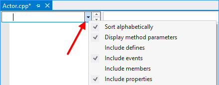

### #9 이름 바꾸기 (Shift+Alt+R)

##### 내장된 이름 바꾸기로 충분할 수 있지만 Visual Assist의 이름 바꾸기는 더 빠르고 강력하며 종종 더 완벽합니다.

심볼의 정의 및 선언의 이름을 바꾸고, 그에 대한 모든 참조를 변경하십시오. 원한다면 주석 및 문자열도 함께 변경할 수 있습니다. 이름을 바꿀 모든 대상은 항상 미리보기에 표시되므로 예상한 대로 이름 바꾸기가 되는 지를 확신 할 수 있습니다. [<i class="fas fa-up-right-from-square"></i>](https://docs.wholetomato.com/default.asp?W154)

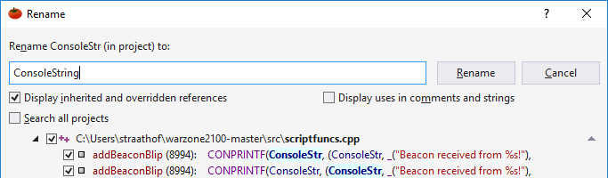

### #10 VA 해시태그 사용

##### 주석에 해시태그를 추가하고 도구 창 (Shift+Alt+H) 또는 GoTo 명령 (Shift+Alt+G)을 통해 주석 사이를 이동합니다.

VA 해시태그는 코드와 함께 이동하는 효과적인 북마크이자 작업 목록입니다. 새 해시태그를 만들거나 기존 키워드 앞에 #을 추가합니다 (예 : #John, #TODO). 간단한 VA 해시태그를 사용해 본 후에는 고급 기능에 대해 알아 보십시오. [<i class="fas fa-up-right-from-square"></i>](https://docs.wholetomato.com/default.asp?W574)

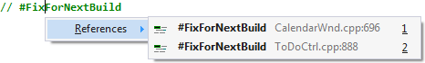
