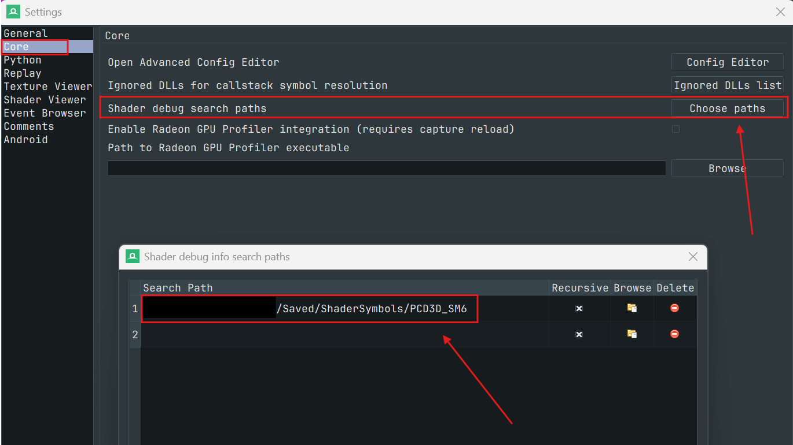

UE에서 RenderDoc으로 HLSL을 한 줄씩 디버깅하려면 설정이 여러 곳에 흩어져 있고, 잘못 넣으면 조용히 무시된다. 실제로 세팅하며 확인한 것을 정리한다.

> **이 글에서 다루는 것**
> - RenderDoc으로 할 수 있는 일
> - 언리얼 쪽에서 **꼭 해야 하는 설정**과 **해 두면 좋은 설정**
> - 팀 설정을 건드리지 않고 **디버그 세션만 따로 띄우는 법** (`-cvarsini`)
> - 실제로 겪은 함정 3가지와 GPU 크래시 사례
>
> **환경**: UE 5.8 (런처 빌드) · Windows · D3D12 (SM6) · RenderDoc v1.46
>
> 모든 cvar와 동작은 **UE 5.8 엔진 소스**와 **RenderDoc 공식 문서**로 확인했다. 근거는 각 항목에 적어 두었다.
{: .prompt-info }

---

시작하기 앞서, 아래는 현재 나의 RenderDoc 디버깅 파일(RenderDocDebug.ini)의 내용이다. 
[RenderDocDebug.ini 다운로드](/posts/UnrealEngine/Debugging/RenderDoc/ue5_renderdoc_shader_debugging/files/RenderDocDebug.ini){: download="RenderDocDebug.ini" }

```ini
[Startup]
; =================================================================================
; RenderDoc HLSL 셰이더 디버깅 전용 세션
; 실행 : UnrealEditor.exe ProjectGray.uproject -skipcompile -AttachRenderDoc -statnamedevents -cvarsini="D:\source\CustomVars.ini"
; 주의 : -gpucrashdebugging 같이 쓰지 말 것(crash 발생) / 이 세션의 GPU 타이밍은 신뢰 불가
; =================================================================================
;
; ---------- [필수] HLSL 소스 디버깅 ----------
;  셰이더 최적화(-Od)를 꺼서 HLSL 변수가 디버거에 그대로 남게 함
r.Shaders.Optimize=0
; 디버그 정보(PDB) 생성 → Saved\ShaderSymbols\PCD3D_SM6에 저장 (RenderDoc Settings > Core > Shader debug search paths 에 등록)
r.Shaders.Symbols=1
;
; ---------- [선택] 셰이더 ----------
; RenderDoc에 셰이더 이름이 보이게 함
r.Shaders.ExtraData=1
; 드라이버의 앱별 최적화를 끔
r.DisableEngineAndAppRegistration=1
; 디버그 셰이더 압축을 생략해 컴파일 시간 단축
r.Shaders.SkipCompression=1

; ---------- [선택] 캡쳐 가독성 ----------
; 텍스처끼리 메모리를 나눠 쓰지 않게 해서, 나중 시점에서 봐도 내용이 덮어써지지 않음 (VRAM 증가)
; r.RDG.TransientAllocator=0
; 모든 패스가 큐 하나에서 순서대로 실행돼 이벤트 순서가 알아보기 쉬움
r.RDG.AsyncCompute=0

; =================================================================================
; 캡처할 때 쓰는 콘솔 명령 (에디터 안에서)
; 
; RDG 패스 이름 + 머터리얼 마커 ON
; r.RHISetGPUCaptureOptions 1
; 다음 프레임 캡쳐 (뷰포트 버튼 / renderdoc.CapturePIE 1도 가능)
; renderdoc.CaptureFrame
; RenderDoc 창 뜬 것 확인 후 OFF
; r.RHISetGPUCaptureOptions 0

; 1. r.RHISetGPUCaptureOptions 1: draw event, r.ShowMaterialDrawEvents=-1, r.RDG.Events=3(RDG 패스 이름 포함)을 한 번에 켬
; 2. renderdoc.CaptureFrame: 다음 프레임을 캡처. 뷰포트의 RenderDoc 버튼을 눌러도 같음.
; 3. r.RHISetGPUCaptureOptions 0: 1번에서 켠 것을 원래대로 되돌림. 캡처가 끝나면 꼭 실행.

; PIE에서 캡처하려면 renderdoc.CapturePIE 1
; ================================================================================
```

`r.Shaders.Optimize=0`을 설정했을 때...

```ini
r.RDG.AsyncCompute=0
```
나만 그런지 모르겠지만, 이것을 설정하지 않으면 `GPU Crash`가 발생한다. 그래서 설정을 해 주었다. 이것을 설정하면 디버깅하기가 더 편해지니 설정한다고해서 손해볼 것은 없다.

---

## 🔍 1. RenderDoc이 해 주는 일

RenderDoc은 **GPU 프레임 디버거**다. 한 프레임 동안 앱이 GPU에 보낸 명령을 통째로 기록(캡처)해 두고, 나중에 그 프레임을 다시 재생하면서 원하는 시점의 GPU 상태를 들여다볼 수 있다.

| 하고 싶은 것 | RenderDoc 기능 |
|---|---|
| 프레임이 어떤 패스로 구성되는지 보기 | **Event Browser**: 마커 트리 (`BasePass`, `Lights`, `Lumen…`) |
| G버퍼, 섀도맵 같은 텍스처 내용 보기 | **Texture Viewer**: 픽셀 값, 밉, 오버레이 |
| 이 draw에 뭐가 바인딩됐는지 보기 | **Pipeline State** |
| 이 픽셀은 왜 이 색인지 추적하기 | **Pixel History** |
| 버텍스가 어디로 변환됐는지 보기 | **Mesh Viewer**: VS 전후 비교 |
| 셰이더를 한 줄씩 실행해 보기 | **Shader Debugger**: D3D12는 VS / PS / CS 지원 |
| 셰이더를 고쳐서 바로 결과 확인 | **Hot shader editing** |

❌ **RenderDoc이 맞지 않는 일**
- **정밀한 GPU 프로파일링**: 공식 문서 표현이 "Simple per-action timings"다. 정밀 측정은 Unreal Insights, `ProfileGPU`, PIX, Nsight 쪽이 맞다.
- **GPU 크래시 분석**: Aftermath나 DRED 쪽이 맞다.

---

## 📋 2. 한눈에 보는 필수 / 선택

목적은 두 단계로 나뉜다. **B는 A를 전제로 한다.**

### A. 프레임 캡처·분석 (패스, 리소스, 상태 보기)

| | 항목 | 비고 |
|---|---|---|
| ✅ 필수 | RenderDoc 설치 | |
| ✅ 필수 | RenderDocPlugin 활성화 | 엔진 기본값이 켜짐 (`EnabledByDefault: true`) |
| ✅ 필수 | 실행 인자 **`-AttachRenderDoc`** | 또는 `renderdoc.AutoAttach=1` |
| ✅ 필수 | D3D12 / Vulkan, Shipping이 아닌 빌드 | |
| ⛔ 금지 | **`-gpucrashdebugging`과 같이 쓰기** | 드라이버 크래시 ([§7 사례 1](#사례-1-renderdoc---gpucrashdebugging--드라이버-크래시)) |
| ➕ 선택 | `r.RHISetGPUCaptureOptions 1` | RDG 패스 이름과 머티리얼 이름 마커 추가 |
| ➕ 선택 | `r.RDG.TransientAllocator=0` | 나중 시점에서도 텍스처 내용 유지 |
| ➕ 선택 | `r.RDG.AsyncCompute=0` | 이벤트가 큐 하나에서 순서대로 보임 |

> **마커는 따로 켜지 않아도 된다.** RenderDoc 플러그인이 캡처하는 동안 draw event를 자동으로 켠다.
>
> ```cpp
> // RenderDocPluginModule.cpp
> UE_GEmitDrawEvents_BeforeCapture = GetEmitDrawEvents();
> SetEmitDrawEvents(true);   // 캡처 시작 시 ON, 끝나면 원복
> ```
>
> 리소스 이름(`GBufferA`, `SceneColor` …)도 Shipping/Test가 아닌 빌드라면 자동으로 붙는다 (`RHI_USE_RESOURCE_DEBUG_NAME=1`).
{: .prompt-tip }

### B. HLSL 셰이더 디버깅 (소스 한 줄씩 실행, 변수 보기)

| | 항목 | 이유 |
|---|---|---|
| ✅ 필수 | A의 필수 전부 | |
| ✅ 필수 | **`r.Shaders.Symbols=1`** | 디버그 정보(PDB) 생성 |
| ✅ 필수 | **RenderDoc에 PDB 검색 경로 등록** | UE는 PDB를 셰이더 본체와 분리해 저장한다 ([§5-②](#-hlsl-소스가-안-보인다면-pdb-검색-경로)) |
| ⭐ 사실상 필수 | **`r.Shaders.Optimize=0`** | 최적화가 켜져 있으면 변수가 사라지고 줄 순서가 뒤섞인다 |
| ➕ 선택 | `r.Shaders.ExtraData=1` | 셰이더 이름 표시 |
| ➕ 선택 | `r.Shaders.SkipCompression=1` | 디버그 셰이더 컴파일 시간 단축 |
| ➕ 선택 | `r.DisableEngineAndAppRegistration=1` | 드라이버의 앱별 최적화 배제 |

---

## 💡 3. 핵심 아이디어: 디버그 세션만 따로 띄우기 (`-cvarsini`)

셰이더 디버깅 설정은 **평소 작업에 켜 두면 안 된다.** 셰이더가 느려지고, 전체 재컴파일이 일어나고, 디스크도 많이 쓴다. 그렇다고 `DefaultEngine.ini`에 넣으면 팀 전체에 퍼진다.

해법은 **실행 인자 `-cvarsini=<파일>`** 이다.

```bat
UnrealEditor.exe "<Project>.uproject" -AttachRenderDoc -cvarsini="D:\Debug\RenderDocDebug.ini"
```

- 그 실행에서만, 내 PC에서만 적용된다.
- 팀 ini는 건드리지 않는다.
- 평소처럼 띄우면 원래 상태로 돌아온다.

### 동작 원리 (UE 5.8 소스 추적)

```
LaunchEngineLoop
 └ FConfigCacheIni::LoadConsoleVariablesFromINI()
    └ FParse::Value(CommandLine, "-cvarsini=", Path)
       └ ApplyCVarSettingsFromIni("Startup", Path,
             ECVF_SetByConsoleVariablesIni, bAllowCheating = true)
```

| 알아둘 점 | 내용 |
|---|---|
| 읽는 섹션 | **`[Startup]`**, `[Startup_Windows]` 만 읽는다 |
| 우선순위 | `DefaultEngine.ini [ConsoleVariables]`나 Device Profile보다 **높다** |
| Cheat cvar | **허용된다** (`bAllowCheating=true`) |
| ReadOnly cvar | ini 경로에서는 설정된다 (ReadOnly 차단은 콘솔 입력에만 있음) |
| 빌드 제약 | Shipping에서는 동작하지 않는다 |
| 파일이 없을 때 | 경고만 뜨고 **조용히 미적용**된다 → 절대 경로를 쓰는 게 안전하다 |

### 예시: `RenderDocDebug.ini`

```ini
[Startup]
; ---------- [필수] HLSL 소스 디버깅 ----------
r.Shaders.Symbols=1
r.Shaders.Optimize=0

; ---------- [선택] 셰이더 ----------
r.Shaders.ExtraData=1
r.DisableEngineAndAppRegistration=1
r.Shaders.SkipCompression=1

; ---------- [선택] 캡처 가독성 / 안정성 ----------
r.RDG.AsyncCompute=0
;r.RDG.TransientAllocator=0
```

### 적용됐는지 확인하기

| 방법 | 기대 결과 |
|---|---|
| 로그 | `LogShaderSymbolExport: Display: Shader symbol export enabled.` |
| 콘솔에 `r.Shaders.Optimize` 입력 | `0` |
| cvar의 `SetBy` 값 | `ConsoleVariablesIni` |

---

## 📸 4. 캡처 워크플로

에디터 콘솔(`~`)에서 **한 줄씩** 입력한다.

```
r.RHISetGPUCaptureOptions 1
renderdoc.CaptureFrame
r.RHISetGPUCaptureOptions 0
```

| 명령 | 하는 일 |
|---|---|
| `r.RHISetGPUCaptureOptions 1` | draw event ON + `r.ShowMaterialDrawEvents=-1` + `r.RDG.Events=3` (RDG 패스 이름) |
| `renderdoc.CaptureFrame` | **다음 프레임**을 캡처하고 RenderDoc을 띄운다 (뷰포트 버튼도 같음) |
| `r.RHISetGPUCaptureOptions 0` | 원래대로 되돌린다. 엔진 설명에 "severe CPU and GPU overhead"라고 적혀 있다 |

> - **이 명령들은 ini에 넣어도 실행되지 않는다.** ini 로더는 키를 cvar로만 찾고, 명령은 실행하지 않는다.
> - **배치로 한꺼번에 실행해도 안 된다.** `CaptureFrame`은 *다음 프레임*을 캡처하므로, 같은 프레임에 `… 0`이 실행되면 마커 없이 찍힌다.
{: .prompt-warning }

🎛️ 쓸 만한 변형:

| 명령 | 하는 일 |
|---|---|
| `renderdoc.CapturePIE 1` | PIE 시작 직후 캡처 |
| `renderdoc.CaptureFrameCount 3` | 3프레임 연속 캡처 (TAA/TSR 히스토리 확인 등) |
| `renderdoc.CaptureDelay 3` | 3초 뒤 캡처 (메뉴 닫을 시간) |

---

## 🚧 5. 꼭 알아야 할 함정 3가지

### ① `r.Shaders.Optimize=0`을 `[ShaderCompiler]` 섹션에 쓰면 무시된다

엔진 기본 ini의 `[ShaderCompiler]` 섹션에 셰이더 설정들이 모여 있어서 거기에 쓰고 싶어지지만, **Optimize는 거기서 동작하지 않는다.**

```cpp
// ShaderCore.cpp — FShaderSettingHelper::GetBoolForPlatform()
if (SettingCVar && SettingCVar->GetInt())   // cvar가 0이 아니면
{
    bEnabled = true;                        // 무조건 true, ini는 안 봄
}
else if (PlatformConfig)                    // cvar가 0일 때만
{
    PlatformConfig->GetValue("ShaderCompiler", SettingName, bEnabled, ...);
}
```

- `r.Shaders.Optimize`의 기본값이 **1**이라 `[ShaderCompiler]`까지 가지 않는다.
- → **cvar 자체를 0으로** 설정해야 한다. `-cvarsini`의 `[Startup]` 섹션이나 `[ConsoleVariables]`에 써야 한다.

### ② HLSL 소스가 안 보인다면: PDB 검색 경로

UE의 D3D 셰이더 컴파일러는 디버그 정보를 **셰이더 본체에서 떼어 따로** 저장한다.

```cpp
// D3DShaderCompilerDXC.cpp
ExtraArguments.Add(TEXT("-Zi"));            // PDB 생성
ExtraArguments.Add("-Qstrip_debug");        // DXIL에서는 제거 → 별도 파일로 저장
```

PDB 저장 위치는 `<Project>/Saved/ShaderSymbols/PCD3D_SM6` 이다. 그래서 RenderDoc이 이 경로를 알아야 한다.

> **RenderDoc → Tools → Settings → Core → Shader debug search paths** 에 `…\Saved\ShaderSymbols\PCD3D_SM6` 추가
{: .prompt-tip }



RenderDoc 공식 문서에서도 PDB 분리 저장을 지원한다고 밝히고 있다: "RenderDoc does fully support the new split pdb information using `/Fd`."

### ③ 프로젝트 설정 화면의 RenderDoc 항목은 팀 전체에 저장된다

`Project Settings → Plugins → RenderDoc` 화면 상단에 이렇게 적혀 있다.

> *These settings are saved in DefaultEngine.ini*

- 클래스 선언이 `UCLASS(config = Engine, defaultconfig)` 이라서 그렇다.
- 여기서 **Auto attach**를 켜고 커밋하면 팀원 전원의 에디터에 RenderDoc이 붙는다.
- **추천: 이 화면은 기본값 그대로 두고, 필요할 때만 실행 인자와 콘솔로 조절한다.**

| 항목 | 추천 |
|---|---|
| Capture all activity | ☐ (켜면 에디터 UI까지 섞임) |
| Capture all call stacks | ☑ (엔진 PDB가 있으면 C++ 함수명까지 보임) |
| Reference all resources / Save all initial states | ☐ (캡처 크기가 크게 늘어남) |
| Auto attach on startup | ☐ (`-AttachRenderDoc` 사용) |
| Use the RenderDoc crash handler | ☐ (RenderDoc 자체 버그 리포트용) |

---

## 🐞 6. RenderDoc에서 셰이더 디버깅 시작하기

| 대상 | 여는 법 |
|---|---|
| **픽셀 셰이더** | Texture Viewer에서 픽셀 선택 → Pixel Context 패널의 **Debug** 버튼 (특정 fragment를 고르려면 **History**) |
| **버텍스 셰이더** | Mesh Viewer에서 버텍스 우클릭 → **Debug vertex** |
| **컴퓨트 셰이더** | Pipeline State의 컴퓨트 영역에서 Group ID와 Thread ID 입력 |

툴바에 **Debug in HLSL**이 보이고 Locals 창에 변수 이름이 나오면 성공이다.

| 단축키 | 동작 |
|---|---|
| F10 / Shift+F10 | 한 줄 진행 / 한 줄 되돌리기 |
| F9 | 브레이크포인트 |
| F5 / Shift+F5 | 끝까지 / 처음까지 실행 |

> **한계**
> - D3D12에서는 VS / PS / CS만 단계 디버깅이 된다 (RenderDoc 문서). 메시 셰이더와 레이 트레이싱 셰이더는 목록에 없다.
> - 엔진이 `CFLAG_ForceOptimization`을 붙이는 셰이더(Nanite 래스터, Lumen 일부, TSR 등)는 `Optimize=0`이어도 최적화된 채로 컴파일된다. 변수 일부가 안 보일 수 있다.
{: .prompt-info }

---

## 🔧 7. 트러블슈팅 사례

### 사례 1: RenderDoc + `-gpucrashdebugging` → 드라이버 크래시
- 💥 **증상**: `renderdoc` → `nvwgf2umx` 0x8 크래시
- 🩹 **대응**: 두 도구를 **절대 같이 쓰지 않는다.** GPU 크래시를 분석할 때는 RenderDoc 없이 `-gpucrashdebugging`만 켜고 실행한다.

### 사례 2: 디버그 셰이더 세션에서만 GPU 크래시 (`DXGI_ERROR_DEVICE_REMOVED`)

`Optimize=0` + `Symbols=1` 세션에서 레벨을 열면, 수 분 안에 GPU 크래시가 났다.

🔎 **로그에서 확인한 것**
- 2번의 크래시 모두 **그래픽스 큐와 비동기 컴퓨트 큐 양쪽에 작업이 진행 중**이었고, 실행 중이던 패스는 매번 달랐다.
  - 1차: Shadow 인스턴스 컬링 / Lumen Radiosity
  - 2차: SkyViewLut / Sky 캡처 AsyncCompute 패스
- VRAM은 충분했다 (4.4 GB / 11.2 GB).
- TDR(GPU 응답 시간 초과)도 아니었다. TdrDelay가 60초인데, 직전까지 프레임이 정상적으로 진행됐다.
- DRED 정보는 비어 있었다 (`No breadcrumb head found`).

🧪 **시도한 것**: ini에 `r.RDG.AsyncCompute=0` 추가 → 20분 동안 크래시 없음.

🤔 **현재 해석 (확정 아님)**
- 비동기 컴퓨트와 관련돼 있을 가능성이 높다.
- `-Od`로 셰이더 실행 시간이 달라지면서 평소에는 드러나지 않던 큐 사이 동기화 문제가 드러났을 수도 있지만, 검증하지 않은 가설이다.
- 확정하려면 `AsyncCompute=0`만 다시 빼서 크래시가 재현되는지 확인해야 한다.

> **교훈**: 디버그 셰이더 세션에는 `r.RDG.AsyncCompute=0`을 기본으로 넣어 두면 안정성과 캡처 가독성을 둘 다 챙길 수 있다.
>
> 단, **큐 동기화 버그 자체를 쫓을 때는** 이 설정이 버그를 가려 버리니 꺼야 한다.
{: .prompt-tip }

---

## 💰 8. 비용 정리

| 설정 | 비용 |
|---|---|
| `r.Shaders.Symbols=1` | 전체 셰이더 재컴파일 + 디스크. 실측: 첫 세션에서 약 **5.9 GB / 27,693개**, 누적되면 **17 GB 이상** |
| `r.Shaders.Optimize=0` | 셰이더 성능 저하. 수치는 셰이더마다 다르니 직접 측정 (`ProfileGPU` A/B) |
| `r.ShowMaterialDrawEvents` | 엔진 설명: "severe CPU and GPU overhead" |
| `r.RDG.TransientAllocator=0` | VRAM 증가 (`rhi.DumpMemory`로 비교) |

> **디버그 세션의 GPU 타이밍은 믿으면 안 된다.** 성능 측정은 `-cvarsini` 없이 따로 실행한다.
{: .prompt-warning }

---

## ✅ 9. 체크리스트

📸 **프레임 캡처만 할 때**
- [ ] `-AttachRenderDoc`
- [ ] `-gpucrashdebugging` 없음

🐞 **HLSL 디버깅까지 할 때**
- [ ] 위 두 항목
- [ ] `-cvarsini="<절대경로>"` + `[Startup]`에 `Symbols=1`, `Optimize=0` (+ `AsyncCompute=0` 권장)
- [ ] 첫 실행 때 셰이더 재컴파일 완료까지 대기
- [ ] 로그에 `Shader symbol export enabled` 확인
- [ ] RenderDoc Shader debug search paths에 `Saved\ShaderSymbols\PCD3D_SM6` 등록
- [ ] 캡처 → Debug → **Debug in HLSL** 확인

---

## 📚 참고

- RenderDoc — [Features](https://renderdoc.org/docs/getting_started/features.html)
- RenderDoc — [How do I debug a shader?](https://renderdoc.org/docs/how/how_debug_shader.html)
- RenderDoc — [How do I use shader debug information?](https://renderdoc.org/docs/how/how_shader_debug_info.html)
- UE 5.8 엔진 소스
  - `Plugins/Developer/RenderDocPlugin/…/RenderDocPluginModule.cpp`, `RenderDocPluginLoader.cpp`
  - `Runtime/Core/Private/Misc/ConfigCacheIni.cpp`, `ConfigUtilities.cpp`
  - `Runtime/RenderCore/Private/ShaderCore.cpp`, `RenderGraphPrivate.cpp`
  - `Runtime/Engine/Private/ShaderCompiler/ShaderCompiler.cpp`
  - `Developer/Windows/ShaderFormatD3D/Private/D3DShaderCompilerDXC.cpp`
  - `Engine/Config/ConsoleVariables.ini` (엔진 자체 주석 예시)
